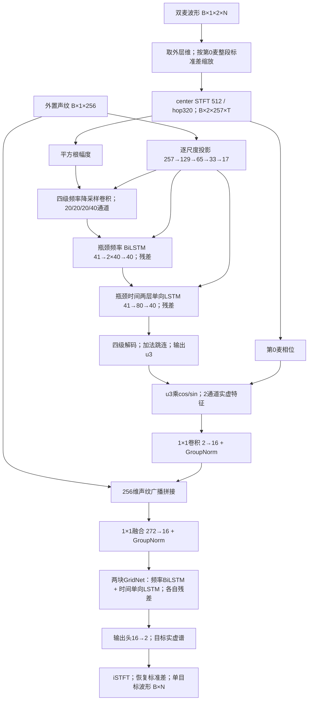

# 小参数单麦 TF-TSE：源码审计与实验设计

日期：2026-11-10。状态：供用户确认的研究设计；没有实现单麦类，没有真实训练或质量结论。

## 1. 证据与边界

本次读取当前项目 README、清单、模型 forward/构造/GridNet、dcunet、训练入口/trainer/loss、bundle/旧数据集、推理与声纹提取；只读核查来源 TF_TSE/models/model_fla_tse.py，以及 FLA 仓库共同研究文档和 upstream 两个模块。未修改两个来源仓库，未复制权重/环境，未发跨 chat 消息。

清单31份文件的当前 SHA-256 和来源文件 SHA-256 均与清单一致。当前目录不是 Git 仓库，无法给出提交差异或提交文档；本次仅新增本文。

使用来源工程已有 .venv/bin/python，从当前项目根目录导入当前代码；Python 3.12.13、torch 2.4.1。重新运行 unittest discover，23项通过（3.272秒），存在旧资源未关闭和依赖弃用警告。随机输入 [1,1,2,16000] 与声纹 [1,1,256]，输出 [1,16000] 且有限。它们只证明当前检查通过，不证明真实语音效果。

## 2. 已验证结构

模型频率形状257→129→65→33→17，解码回257；时间长度保持。前端不是纯卷积。后端2通道是实部/虚部，不是麦克风。后端没有完整原混音复数谱旁路。u3没有强制为非负，也没有明确做平方还原，宜称前端谱特征，不能直接称目标物理幅度。

模型默认16k、FFT512、窗512（32ms）、hop320（20ms）、Hann、默认center=True；20ms是帧移，不是端到端延迟。整段标准差、GroupNorm和居中STFT均引入非流式因素。代码先调用一次mag_phase iSTFT，随后被real_imag iSTFT覆盖，前一次结果不影响最终输出，仍消耗计算。

## 3. 实例化参数

原配置 fc_dim=16、hidden=32、2块GridNet、emb_ks=emb_hs=1。总参数与可训练参数均298,238；不含外置声纹网络，已含盒端所有条件层。BN运行统计是buffer，不属于参数个数，部署内存仍需计入。

| 模块 | 参数 | 占比 |
|---|---:|---:|
| 前端声纹投影l1–l5 | 110,537 | 37.06% |
| 前端频率LSTM及投影 | 29,800 | 9.99% |
| 前端时间LSTM及投影 | 94,440 | 31.67% |
| 前端编码器与解码器 | 17,283 | 5.80% |
| 后端入口、声纹融合、输出头 | 4,514 | 1.51% |
| 两块GridNet | 41,664 | 13.97% |
| 合计 | 298,238 | 100% |

逐项复核：l1/l2/l3/l4/l5=66,049/33,282/8,450/2,178/578；编码器=360/2,160/2,160/4,320；解码器=4,060/2,060/2,060/103；conv/fusion/deconv=80/4,400/34。

每块GridNet：频率norm32 + BiLSTM12,800 + 投影1,040；时间norm32 + LSTM6,400 + 投影528，共20,832。两块时间分支（含norm与投影）仅13,920参数，因此T1即使完全省去该部分，也不能大幅压缩整个模型。

CConv2d实际是实数wav_conv，并自动in_channels+1。原首层weight=[20,3,5,1]：2音频通道+1条件。内存中仅替换为[20,2,5,1]的参数探针，完整计数298,138，比双麦少100。此探针不是已完成单麦模型，也没有执行单麦forward。最小单麦改法预期保留其余模块占比，编码解码器17,183参数。

## 4. 计算与当前风险

CPU arm64、torch单线程、eval/inference_mode、FP32，1秒16k随机输入、batch1，预热3次后10次：中位38.28ms，范围38.11–38.50ms。进程峰值RSS269,287,424字节，包含解释器/导入/模型，不能当作模型独占峰值。该耗时包含当前冗余iSTFT，无真实芯片意义；短输入与整段未来信息也不能证明流式实时。

按forward实际形状，只统计LSTM输入/循环权重矩阵乘加，1 MAC=一次乘加，不含bias、门激活、线性输出、卷积、FFT或归一化：

| 模块 | MAC / 1秒输入 |
|---|---:|
| 前端频率LSTM | 22,472,640 |
| 前端时间LSTM | 77,960,640 |
| 后端频率BiLSTM，两块 | 322,117,632 |
| 后端时间LSTM，两块 | 161,058,816 |
| LSTM部分合计 | 583,609,728 |

后端占上述LSTM MAC约82.8%。这是部分算子统计，不是完整模型MAC。后续统一在1/4/10秒输入上测完整支持算子覆盖、RTF、峰值内存，并明确硬件、线程、精度、warmup、重复次数及是否包含STFT。

新增审计发现，需在实现前明确处理：

1. **前端时间维还原错序。** 时间LSTM输入按[B,F,T,C]展平为[B×F,T,C]，输出却直接view(B,T,F,C-1)，再permute。正确还原应先view(B,F,T,C-1)，再转到[B,C-1,F,T]。标签探针F=2/T=3期望时间优先顺序[0,3,1,4,2,5]，旧路径为[0,1,2,3,4,5]。这是可验证的索引不一致；旧权重行为依赖旧布局，不能静默改后宣称兼容/质量不变。先保留legacy，新增修正对照；影响大小待训练测量。
2. **原配置默认正值截断。** trainer的legacy_positive_clamp默认为True，训练loss前把预测和参考截到[1e-10,1e10]，负半波消失；验证不做同样截断。loss公式线索正确，但漏掉这一重要前置变换。来源复现保留，统一研究基线明确关闭并单列结果。
3. **iSTFT未显式给原长度。** 推理入口补到320边界且至少640，再裁回原长；验证和新训练需统一长度契约，不能靠裁短丢有效样本。
4. **padding loss不等于padding完全不影响模型。** 模型标准差/归一化仍看padding；频谱mask通过帧中心<=length保留帧，边界会接触补零，不能称严格逐条裁剪等价。
5. **旧数据主链不满足第一阶段协议。** 含随机混响/无混响、双麦几何、逐源空间能量补偿及共享噪声；需独立单麦受控混音链。旧训练同时把同一混音与两人的声纹/参考拼成双倍batch，是有价值的条件交换行为，应保留思想。

其余任务线索均与代码一致：BN变体仅继承并替换conv/fusion_conv两处GroupNorm；bundle的duplicate只适配旧接口；其mask为有效前缀样本，不是VAD。旧在线数据输出麦序[mic2,mic1]，参考取mic2，与模型第0麦一致；新数据不能凭变量名把它改成mic1。

## 5. loss、数据与声纹契约

### 来源事实

普通分支为负SI-SNR + FFT512/256/128实/虚/幅度九项L1 + 0.01×pw，且可能先正值截断。pw是对非活动区域预测/参考去均值能量差取绝对值后做10log10，并非普通线性能量L1。padding_aware分支为有效长度负SI-SNR + 多分辨率谱L1，不用pw，要求关闭正值截断。验证主要是负SI-SNR；padding-aware额外记录输入/输出SI-SNR，当前索引mixture[:,0,0]依赖旧4D接口。无PIT。

### 建议研究契约（待锁定）

- 真单麦模型主接口mix=[B,1,N]、embedding=[B,1,256]、target/output=[B,N]、lengths=[B]。只接受明确形状，batch1仍保留麦维，拒绝双麦输入；数据单样本mix=[1,N]，训练器不再加旧包装维。
- 16k为建议，未经用户锁定不作跨路线公平分数。T0保持FFT512/窗512/hop320和center设置；改变STFT另立实验。
- 样本记录mix_id、目标/干扰/注册说话人ID、原录音/会话ID、裁剪、增益、SIR定义、延迟、最终公共缩放、活动区间、有效长度、speaker_present及生成seed。按说话人划分，验证/测试清单固定并存哈希；注册与目标独立，优先跨录音/会话。拒绝空音频、非有限、错误采样率、错位参考、全零embedding。
- 第一阶段受控干净混音：SIR建议-10/-5/0/+5/+10dB，按双方活动区能量计算并记录；覆盖不同重叠率、单独目标、目标暂停、完全缺席。之后才加自由场增益/延迟与噪声，参考为同一麦位置的目标传播版本。混音/参考同缩放，不再逐源消除距离增益。
- 固定ResNet34_yk版本和权重哈希；已有源码注册预处理为去均值/标准差、16k 80维logFbank（FFT512/窗400/hop160），输出L2归一化256维。现有缓存/任意npy只校验形状和有限性，不能保证来自同一权重或单位范数；新缓存应存上述元数据。T0不更换声纹网络或另加融合策略。
- 来源loss复现和研究loss分开命名。研究建议活动样本使用有效长度负SI-SNR + λ谱L1；先在相同样本审计loss值及梯度量级，再只用验证集选λ。缺席样本使用有效长度内输出L1/能量分支，不进入普通SI-SNR。目标暂停与padding分别标记。
- 主指标活动目标SI-SNR/SI-SNRi，按SIR、重叠率、相似声纹、说话人分组；目标独说保真（SI-SNR及增益误差），暂停/缺席输出RMS和相对混音衰减，必要时干扰投影泄漏与STOI。静音不混入常规SI-SNR均值。更换同一混音的两人注册，分别对各自参考评分；置零/打乱声纹只作诊断。

## 6. 方案选择与优先级

可选路径：A，先T0与来源行为核对，再T1单时间模块；B，直接完整后端F/T替换；C，先大幅删前端再增加FLA。推荐A：解释性最强，能先排除单麦接口、布局和loss造成的混淆。B一次改变FFN/归一化/残差，适合整体架构比较但不能归因FLA；C可能有更大参数收益，但最易把前端目标筛选能力一起损伤。

| 顺序/ID | 唯一主要变化 | 比较对象/要回答的问题 |
|---|---|---|
| R0 | 来源代码与loss原样 | 保存298,238参数来源参照；无数据暂不产生分数 |
| T0-L | 真单麦，保留legacy布局 | 298,138预期；先证明接口、参考与显式checkpoint映射 |
| T0-F | 只修复时间布局 | 与T0-L相同loss/数据，从头训练，单列布局影响 |
| T0-U | 固定选定布局，统一loss契约 | 后续架构统一锚点；正值截断等变化独立记录 |
| T1 | 只换后端时间LSTM/投影为Gated FLA增量 | 保留频率BiLSTM、前端、norm/残差接口 |
| T1-context | 可比未来上下文控制 | 全段FLA对照后端时间BiLSTM并匹配预算；其余相同 |
| T2 | 后端整体改F-MHSA/T-FLA及FFN | 称整体后端比较，明确单残差研究版与上游兼容版 |
| T3-delete | 固定选定后端，只缩/移除前端瓶颈F/T | 是否重复建模，目标筛选是否退化 |
| T3-budget | 把T3节约预算重新分给后端 | 与纯删减、原前端做等参数对照 |
| T4 | 接入原混音实虚谱并小投影融合 | 目标细节恢复与干扰泄漏的取舍 |
| T5 | 改小投影拼接/逐块FiLM/条件残差门控 | 固定声纹与较优主干，是否有效选人 |

T1沿每个频点的时间轴运行，输入输出[B×257,T,16]。沿用一个显式外部残差，FLA适配器返回增量；不能把内部已带残差的Linear_Attn_Template结果再次当纯增量相加。保持或明确替代已有inter_norm，避免无意双norm。全段FLA有未来信息，原时间LSTM单向；整网本来离线不消除这个局部上下文差异。预算与计算允许时补相近参数时间BiLSTM；可比因果FLA另立后续研究。

T2引用上游时保留快照、来源及LICENSE，新行为放独立文件。上游时间分支存在内外重复残差是已验证事实；新块显式采用单残差，发布checkpoint兼容行为另保留。旧TF_TSE/model_fla_tse.py确实保留前端、整组替换后端；336,350的历史报告本次未重新实例化，不作新证据。

## 7. 参数预算与训练预算

小档以T0约298k为锚，匹配总参数±10%；大档以800k为锚，匹配±10%，任何方案必须<1,000,000。不通过添加不执行的参数凑预算；冻结参数仍计数。T1若保持16维直接换FLA，很可能低于对应分支预算，应报告实际总数并用真实投影/注意力宽度作匹配，不额外叠加时间LSTM。

大档可以先保留前端不变，仅扩后端。GridNet ks=hs=1、后端宽C/隐H/层数L时，每块参数为15HC+12H²+24H+6C；入口/融合/输出为C²+266C+2。原前端总252,060。C=48/H=64/L=6时双麦总849,470，最小单麦849,370（公式候选，未实例化验证）；可作800k档起点，不能作为最终已验证模型。FLA档以实例化总参数调宽/FFN，不照搬大模型。

初轮训练建议先小档、同种子3407、同数据manifest、同batch有效样本数与优化步数；短跑建议2,000步仅检查下降、有限梯度、条件交换和泄漏，不能排名定论。全量预算待语料/硬件确认后锁定，统一max_steps、有效音频小时、采样策略、优化器/调度、precision；记录实际训练时间。有希望方案再用至少3种子复核。约800k档在小档协议稳定后进入。参数匹配与训练预算匹配不能替代计算成本报告。

## 8. 首个最小实现与验收边界

设计获确认后先做T0接口实现，不修改原双麦类/配置。新单麦类与配置独立命名，统一数据/推理/验证参考索引，明确valid length，不依赖会吞麦维的squeeze。

checkpoint迁移仅允许明确的首层变换：若把旧两麦视为相同信号，可将两个音频kernel求和作为单麦kernel，条件kernel原样复制；其余key/shape严格一致。也可选参考麦kernel保留方案，但不等价复制双麦输入，需独立标注。迁移报告所有变换、遗漏/多余key（应为0），strict=True加载变换后state。只在保留旧布局且旧输入两路相同的条件下可检查数值映射等价；这不是物理双麦等价或真实效果保证。修正布局与迁移微调分开，默认新架构从头训练。

最小验收：batch1/2、长短非整hop、全静音数值稳定、有限输出与梯度、原长完整保留、拒绝错误维度/声纹、单麦总参数<1M、首层少100、旧双麦回归通过、时间布局标签测试、推理/验证索引一致、有效长度和目标缺席loss分支。现有数据无权重时只做合成接口检查，不声称目标选择成功。

## 9. 需用户锁定的条件

1. 两路线统一16k是否接受（推荐接受；原TF基线已为16k）。
2. 可用语料/embedding或声纹权重的位置、许可范围、跨说话人划分是否已有；尚无数据时继续接口工作。
3. 是否接受“保留legacy来源，修正时间布局作独立对照，统一研究loss关闭正值截断”的研究顺序（推荐接受）。
4. 训练硬件及短跑/全量预算；目前无远端训练授权。

以上待确认不影响本轮源码审计；影响后续训练配置与架构结果解释。用户确认本文后再逐实验实现。

后续校正（2026-11-10）：case实例化发现上版预算公式漏计3HC，本文公式及C48/H64/L6例数已更正；实际服务器case采用C64/H88/L3，实测812,794参数，详见server-cases文档。
